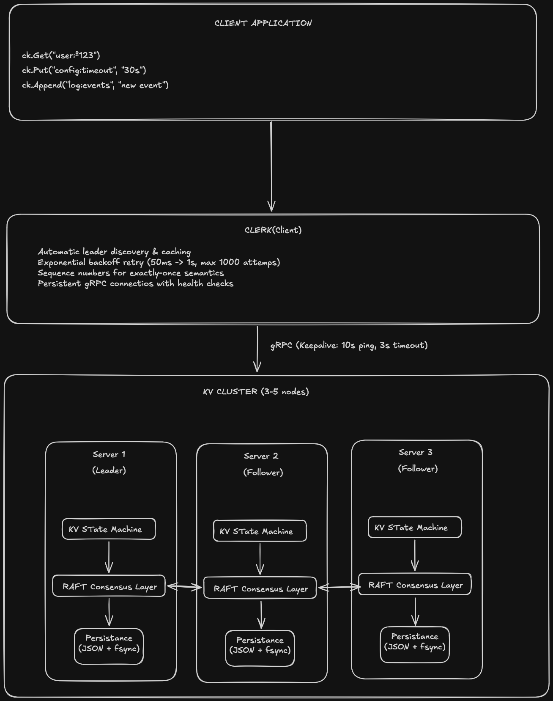

# distribKV

A distributed key-value store built from scratch in Go: Raft leader election, log replication, persistence, snapshotting, and a gRPC client library. Three nodes, no etcd, no consensus library.

**Go 1.25** · **Raft labs 2A–2D + KV server (lab 3)** · **124 tests** · **raft 86% covered** · **4 direct dependencies**

## Run it

```bash
make run      # starts 3 nodes locally, logs in .run/
make smoke    # Put/Append/Get through the Clerk client
make stop
```

Or with Docker:

```bash
make cluster-up     # 3 replicas + healthchecks
make cluster-logs
make cluster-down
```

## Why this exists

Most backend work hides the hard parts of distributed systems behind a managed database. This project surfaces them: how a cluster agrees on a value when networks partition, clocks drift, and nodes crash mid-write.

It follows the [MIT 6.824](https://pdos.csail.mit.edu/6.824/) progression, implementing Raft labs 2A–2D and the KV server from lab 3, with production-shaped engineering around it: `-race` on every test, atomic persistence, deterministic shutdown, config-driven deployment, Docker.

## What's actually implemented

- **Leader election** with randomized 150–300ms timeouts from config, term-based voting, and log up-to-dateness checks
- **Log replication** with conflict truncation, `nextIndex`/`matchIndex` backtracking, and the Figure 8 commit rule (only entries from the current term are committed directly)
- **Durable state**: `currentTerm`, `votedFor`, and the log are persisted before any RPC reply, via temp file + `f.Sync()` + `os.Rename`
- **Snapshotting**: local compaction on an applied-entry threshold, restart recovery, and an `InstallSnapshot` RPC that catches up followers whose `nextIndex` has fallen behind the leader's compacted base
- **KV state machine**: `Get`/`Put`/`Append` applied from the Raft log, with duplicate suppression, wrong-leader hints, and bounded pending-op tracking
- **Clerk client**: lazy dial, exponential backoff (50ms→1s), 1000-attempt retry, transparent failover on leader change
- **Operations**: health gRPC service, distroless image, `docker-compose` with healthchecks, `make smoke` sanity check

### Details worth reading the code for

- **Three goroutines per node**, no `sync.Cond` anywhere: election timer (`time.AfterFunc` + `Reset`), leader-only heartbeat sender, apply loop. Shutdown is `context` cancellation plus a `WaitGroup`, and it is idempotent.
- **No RPCs under a lock.** Peer IDs are collected under the mutex, then the lock is released before fanning out. This was the single most common deadlock source in the earlier prototype.
- **Log indexing is `logBase`-relative**: `commitIndex`, `lastApplied`, `nextIndex`, and `matchIndex` are absolute Raft indices, while the slice is 0-indexed past a moving base. Snapshotting changes only `logBase`; every read site shares the same arithmetic.
- **Dedup rides in the snapshot.** The `clientId`/`seqNum` cache (cap 100/client, 10s TTL) is serialized alongside KV state, so retries aren't re-executed after a restart that recovered from a snapshot.
- **Corruption is a first-class case.** Snapshots carry a 24-byte header (`DSKVSNP1` magic + index/term). A corrupt snapshot degrades to no-snapshot behavior instead of discarding otherwise-valid Raft state.

## Architecture



Two layers, one binary:

**Raft** (`raft/`) owns consensus: election, replication, persistence, compaction. It knows nothing about keys or values.

**KV** (`kv/`) is the state machine. It consumes an `ApplyMsg` channel, applies committed entries, and answers clients. Every read is a log entry, which is what makes reads linearizable without a separate ReadIndex path.

Node identity is opaque. IDs come from `cluster.yaml` and each binary matches itself by `-id`; IDs are never derived from ports or addresses.

## Testing

124 test functions (78 in `raft`) across two suites per package:

- `*_test.go` — blackbox scenarios through the public API (`package raft_test`)
- `*_internal_test.go` — whitebox assertions on private state (`state`, `commitIndex`, `log`, step-down behavior)

The suite is race-detector-only (`go test -race ./...`), uses `testify` for `require`/`assert`, and handles async conditions with `require.Eventually`/`Never` rather than sleeping. The one fixed sleep in the suite asserts that *nothing* happens before `Start()` is called, which is the one case a window is the right tool. Persistence tests always write to `t.TempDir()`.

| Package | Coverage |
|---|---|
| `raft` | 86.2% |
| `config` | 92.3% |
| `server` | 81.4% |
| `kv` | 65.1% |
| `health` | 61.8% |
| **total** | **64.6%** |

The total is pulled down by `cmd/kvserver` (no tests: it is `main` wiring) and the generated `*.pb.go` files. The consensus layer, which is where the bugs live, is the most covered.

## Limitations

A Raft implementation is only honest when it names what it doesn't do.

| Not implemented | Consequence | Next step |
|---|---|---|
| Membership changes (Raft §6) | Cluster size and IDs are fixed at config time; resizing means restarting every node | Single-server changes, then joint consensus |
| TLS and auth | gRPC is plaintext: anything on the network can read or mutate the store | mTLS with certificate rotation |
| ReadIndex / lease reads | Correct but expensive: every read costs a log append and an fsync | ReadIndex confirmed by a heartbeat quorum |
| Chunked snapshots | Single chunk, 4MB cap; larger state can't be shipped to a follower | Streaming `InstallSnapshot` |
| Dedup durability without a snapshot | With `snapshot_threshold: 0` a restart loses the dedup cache, so a retried `Append` in that window can apply twice | Default threshold above zero, or persist dedup separately |
| CI | Quality is measured locally, not enforced on pull requests | GitHub Actions running `go test -race ./...` and `go vet ./...` |

## Project structure

```
distribKV/
├── cmd/
│   ├── kvserver/      # single binary (server + healthcheck subcommand)
│   └── smoke/         # operator Put/Append/Get sanity check
├── config/            # cluster.yaml parsing
├── raft/              # consensus engine + test harness
├── kv/                # KV state machine + Clerk client
├── server/            # binary wiring (run.go, grpc.go)
├── health/            # health gRPC service
├── proto/             # .proto sources (raft, kv, health)
├── configs/           # cluster.yaml (local), cluster-docker.yaml (containers)
├── docker-compose.yml
├── Dockerfile         # multi-stage build, distroless/static runtime
└── Makefile           # proto/build/test/run/smoke/cluster-* targets
```

Generated `.pb.go` files live in the consuming package. Raft is the exception: it uses `raft/raftpb/`, because the generated `LogEntry` embeds a `sync.Mutex` and ranging over a slice of them fails `go vet`. `raft` keeps a plain domain `LogEntry` for in-package use and converts only at the RPC boundary.

## Configuration

```yaml
cluster:
  name: distribkv-dev
  heartbeat_interval: 50ms
  election_timeout_min: 150ms
  election_timeout_max: 300ms
  data_dir: ./data              # /var/lib/distribkv in the container stack
  snapshot_threshold: 0         # applied entries since last snapshot; 0 = never

nodes:
  - id: 1
    listen_addr: "0.0.0.0:10001"
  - id: 2
    listen_addr: "0.0.0.0:10002"
  - id: 3
    listen_addr: "0.0.0.0:10003"
```

```bash
bin/kvserver -config configs/cluster.yaml -id 1 -log.level info -log.format text
```

## Build commands

```bash
make proto        # regenerate .pb.go from .proto (never hand-edit them)
make build        # build ./cmd/kvserver to bin/
make test         # go test -race -cover ./...
make test-cover   # open the HTML coverage report
make fmt
make tidy
```

## References

- [Raft paper](https://raft.github.io/raft.pdf) — the algorithm, sections 2–5 and 7
- [Raft visualization](https://raft.github.io/) — interactive demo
- [MIT 6.824](https://pdos.csail.mit.edu/6.824/) — the course that sets the bar
- [PLAN.md](PLAN.md) — version history and design decisions

## License

MIT. See [LICENSE](LICENSE).

---

Built as a learning project. The interesting failures are documented in [PLAN.md](PLAN.md) and [AGENTS.md](AGENTS.md).
